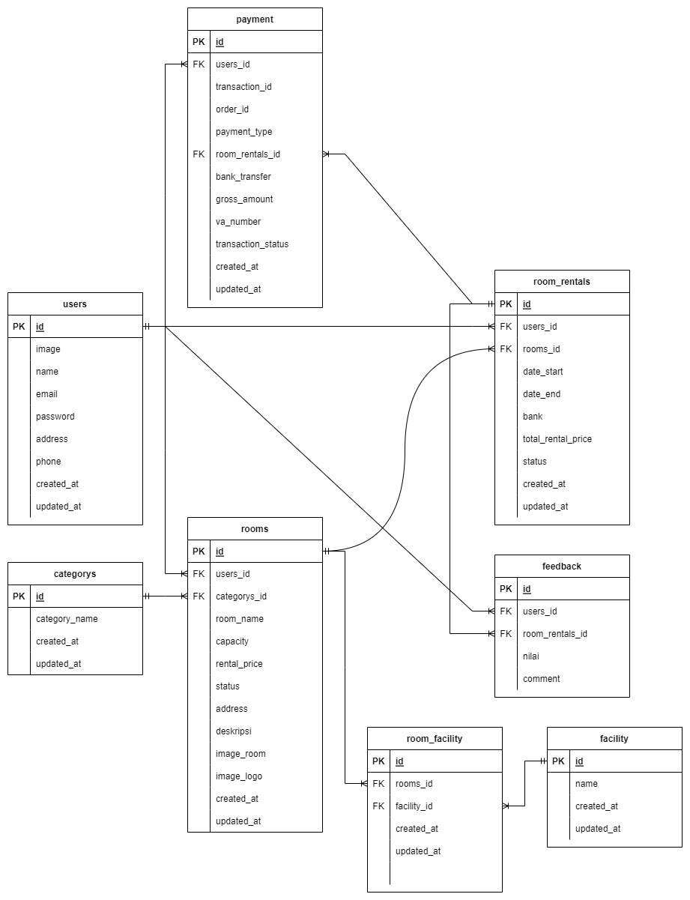

# MN Room - Project Capstone Group 4

<!-- PROJECT LOGO -->
<br/>
<div align="center">
  <a href="https://github.com/Capstone-MNRoom">
    
  </a>

  <h3 align="center">MN Room Backend API</h3>

  <p align="center">
    Platform reservasi dan penyewaan ruangan daring berbasis RESTful API dengan integrasi Payment Gateway & Cloud Storage.
    <br />
    <a href="https://app.swaggerhub.com/apis-docs/davidwah/MNROOM/1.0#/"><strong>» Open API Swagger »</strong></a>
  </p>
</div>

---

### 🛠 &nbsp;Tech Stack & Tools

&nbsp;
&nbsp;
&nbsp;
&nbsp;
&nbsp;
&nbsp;
&nbsp;
&nbsp;

---

## 📖 About Project
**MN-Room** merupakan proyek backend capstone yang dirancang untuk mengatasi permasalahan *double-booking* saat penyewaan ruangan acara. MN-Room menyediakan pencatatan ketersediaan ruangan secara real-time, pemesanan online, serta verifikasi pembayaran otomatis melalui Payment Gateway.

### ✨ Fitur Arsitektur & Modernisasi Terbaru
- **Clean Architecture (Package by Feature):** Pemisahan domain yang rapi antara `presentation` (HTTP Controller & DTO), `business` (Use Case), `data` (GORM Repository), dan `entity` (Interface contract).
- **Full `context.Context` Propagation:** Aliran context dari HTTP Request Echo hingga eksekusi query GORM database (`db.WithContext(ctx)`), mencegah pemborosan resource saat request dibatalkan/timeout.
- **Database Connection Pooling:** Pengaturan pool koneksi MySQL (`MaxOpenConns`, `MaxIdleConns`, `ConnMaxLifetime`, `ConnMaxIdleTime`) untuk mencegah masalah *too many connections* dan *broken pipe*.
- **Graceful Shutdown Server:** Menangkap sinyal sistem (`SIGINT`, `SIGTERM`) untuk menyelesaikan request yang sedang berjalan dan menutup koneksi database secara bersih sebelum aplikasi berhenti.
- **Modernized Dependencies:** 
  - Go Runtime 1.22+
  - JWT v5 (`github.com/golang-jwt/jwt/v5` & `github.com/labstack/echo-jwt/v4`)
  - Go Playground Validator v10 (`github.com/go-playground/validator/v10`)
  - Standar Google Cloud Storage SDK & pembersihan deprecated AppEngine context
  - Multi-stage Docker image berbasis `golang:1.22-alpine` dan `alpine:3.20`

---

## 🚀 Getting Started

### Prasyarat
- [Go](https://go.dev/dl/) versi 1.22 atau lebih baru
- [MySQL](https://www.mysql.com/) versi 8.0+
- [Docker](https://www.docker.com/) (opsional)

### Environment Variables
Buat konfigurasi environment variables berikut sebelum menjalankan aplikasi:
```bash
# Database Configuration
export DB_USERNAME="root"
export DB_PASSWORD="your_password"
export DB_PORT="3306"
export DB_HOST="localhost"
export DB_NAME="mnroom"

# Cloud & Storage Configuration
export DB_BUCKET="your-gcs-bucket-name"
# Pastikan file key.json kredensial GCP tersedia di root folder

# Midtrans Configuration
export SERVER_KEY="your-midtrans-server-key"
```

### Menjalankan Aplikasi
```bash
# 1. Download & sinkronisasi dependensi
go mod tidy

# 2. Jalankan aplikasi
go run main.go
```

### Menjalankan dengan Docker
```bash
# Build image
docker build -t alta-mnroom:latest .

# Run container
docker run -p 8000:8000 --env-file .env alta-mnroom:latest
```

---

## 📌 Endpoint API

<details>
<summary>🙎 <b>Users & Auth</b></summary>
<br>

| Method | Endpoint | Param | Auth (JWT) | Deskripsi |
| :--- | :--- | :--- | :---: | :--- |
| `POST` | `/signup` | - | ❌ | Registrasi user baru |
| `POST` | `/login` | - | ❌ | Otentikasi user & generate JWT token |
| `GET` | `/users` | - | ✅ | Mendapatkan daftar seluruh user |
| `GET` | `/users/profile` | - | ✅ | Mendapatkan profil user yang sedang login |
| `PUT` | `/users` | - | ✅ | Memperbarui profil user yang sedang login | 
| `DELETE` | `/users` | - | ✅ | Menghapus akun user yang sedang login |

</details>  

<details>
<summary>🛍️ <b>Rooms & Facility</b></summary>
<br>

| Method | Endpoint | Param | Auth (JWT) | Deskripsi |
| :--- | :--- | :--- | :---: | :--- |
| `POST` | `/rooms` | - | ✅ | Mendaftarkan ruangan baru (mendukung upload foto) |
| `GET` | `/rooms` | `page` | ❌ | Mendapatkan katalog seluruh ruangan (dengan paginasi) |
| `GET` | `/rooms/:id` | `id` | ❌ | Mendapatkan detail informasi ruangan berdasarkan ID |
| `PUT` | `/rooms/:id` | `id` | ✅ | Memperbarui informasi profil ruangan |
| `DELETE` | `/rooms/:id` | `id` | ✅ | Menghapus data ruangan berdasarkan ID |
| `GET` | `/users/rooms` | - | ✅ | Mendapatkan daftar ruangan milik user yang sedang login |
| `GET` | `/rooms/category` | `category` | ❌ | Filter daftar ruangan berdasarkan ID kategori |
| `GET` | `/rooms/:id/facility` | `id` | ✅ | Mendapatkan daftar fasilitas yang dimiliki sebuah ruangan |

</details>

<details>
<summary>🏷️ <b>Categories & Facilities Master</b></summary>
<br>

| Method | Endpoint | Param | Auth (JWT) | Deskripsi |
| :--- | :--- | :--- | :---: | :--- |
| `POST` | `/categorys` | - | ❌ | Menambahkan kategori ruangan baru |
| `GET` | `/categorys` | - | ❌ | Mendapatkan daftar seluruh kategori |
| `GET` | `/categorys/:id` | `id` | ❌ | Mendapatkan detail kategori berdasarkan ID |
| `PUT` | `/categorys/:id` | `id` | ❌ | Memperbarui data kategori |
| `DELETE` | `/categorys/:id` | `id` | ❌ | Menghapus kategori |
| `POST` | `/facilitys` | - | ❌ | Menambahkan fasilitas baru |
| `GET` | `/facilitys` | - | ❌ | Mendapatkan daftar seluruh fasilitas |
| `GET` | `/facilitys/:id` | `id` | ❌ | Mendapatkan detail fasilitas berdasarkan ID |
| `PUT` | `/facilitys/:id` | `id` | ❌ | Memperbarui data fasilitas |
| `DELETE` | `/facilitys/:id` | `id` | ❌ | Menghapus fasilitas |

</details>

<details>
<summary>🛒 <b>Rents & History</b></summary>
<br>

| Method | Endpoint | Param | Auth (JWT) | Deskripsi |
| :--- | :--- | :--- | :---: | :--- |
| `POST` | `/rents` | - | ✅ | Melakukan sewa ruangan & membuat tagihan pembayaran |
| `GET` | `/rents/:id` | `id` | ✅ | Mendapatkan informasi detail sewa berdasarkan ID ruangan |
| `GET` | `/historys` | - | ✅ | Mendapatkan riwayat seluruh sewa user yang login |

</details>

<details>
<summary>💳 <b>Payments (Midtrans)</b></summary>
<br>

| Method | Endpoint | Param | Auth (JWT) | Deskripsi |
| :--- | :--- | :--- | :---: | :--- |
| `GET` | `/payments` | - | ✅ | Mendapatkan riwayat pembayaran user |
| `POST` | `/payments/status` | - | ❌ | Webhook notifikasi callback status transaksi Midtrans |

</details>

<details>
<summary>⭐ <b>Feedback & Review</b></summary>
<br>

| Method | Endpoint | Param | Auth (JWT) | Deskripsi |
| :--- | :--- | :--- | :---: | :--- |
| `POST` | `/feedbacks` | - | ✅ | Memberikan rating dan komentar untuk ruangan |
| `GET` | `/feedbacks/:id` | `id` | ❌ | Mendapatkan seluruh feedback/review pada sebuah ruangan |

</details>

---

## 📈 Entity Relationship Diagram (ERD)
<div align="center">
  
</div>

---

### 👥 Contributors

[](https://github.com/mohamadazisadnan)
[](https://www.linkedin.com/in/azisadnn/)

[](https://github.com/davidwah)
[](https://www.linkedin.com/in/david-wahyu-pratomo/)

[](https://github.com/mulyanurdin10)
[](https://www.linkedin.com/in/mulya-nurdin-473807246/)
